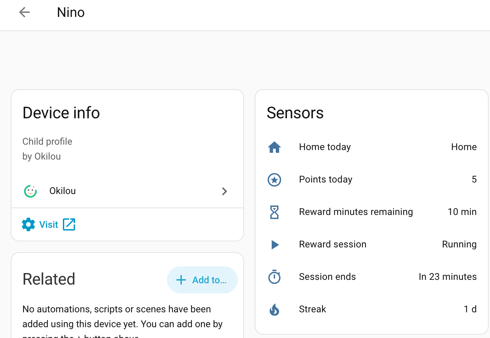

# Okilou for Home Assistant

[Okilou](https://okilou.fr/?src=ha) is the neutral referee of the household: parents and children agree in advance on the conditions (homework done, room tidied) and on what they unlock (screen time, outings). This read-only integration exposes each child's day as sensors and relays new facts as events.



**You need the Okilou app and an account.** The app is currently available in France and Switzerland (French, English and German). This is a cloud integration: Home Assistant polls the Okilou API every 60 seconds.

- One **household token**, created and revocable in the app (Settings, Your household, API & home automation).
- One **device per child**: remaining minutes, points, streak, running session (`ends_at` known at start), and a shared-custody "home today" sensor. On the other home's days, no data crosses over.
- **`okilou_event`** bus events (`behavior_validated`, `session_started`, `menu_item_consumed`, `cheer_sent`) with `childId` and `childName`.
- API spec: [`openapi.yaml`](openapi.yaml). Community clients welcome: open an issue and we will feature your project.

Install: Settings, Marketplace, **Add from link**, paste this repository's URL. The setup starts right after the install, no restart needed. Then paste your token.

---

# En français

Cette intégration expose l'état du jour de chaque enfant et relaie les faits du journal sur le bus, en lecture seule. L'app reste le seul endroit où l'on valide.

- **Lecture seule** : l'intégration ne peut rien écrire ni valider.
- **Un jeton par foyer**, créé et révocable dans l'app (Réglages → Ton foyer →
  API & domotique). Il couvre tous les enfants du foyer.
- **Garde alternée** : le jour où l'enfant est dans son autre maison, les
  capteurs se mettent en veille. Aucune donnée de l'autre foyer ne transite.
- **Service en ligne** : il faut l'app et un compte Okilou (disponible en France
  et en Suisse). Latence : l'app synchronise en 4 à 60 s, l'intégration interroge
  toutes les 60 s. Comptez 30 s à 2 min entre un geste dans l'app et sa trace ici.

## Installation

### Via la Marketplace (Home Assistant 2026.11 et suivants)

1. Paramètres → Marketplace → **Add from link** → coller
   `https://github.com/okilou/okilou-homeassistant`. Home Assistant demande une
   connexion GitHub pour cet ajout par lien.
2. Installer **Okilou** : la configuration s'ouvre aussitôt, sans redémarrage.
3. Coller le **jeton du foyer** (`rf_api_…`) créé dans l'app.

[](https://my.home-assistant.io/redirect/config_flow_start/?domain=okilou)

### Avec HACS (avant 2026.11)

HACS → menu ⋮ → **Custom repositories** → ajouter l'URL du dépôt (type
*Integration*), installer **Okilou**, redémarrer, puis Paramètres → Appareils et
services → **Ajouter une intégration** → Okilou.

### Manuellement

Copier `custom_components/okilou/` dans le dossier `custom_components/` de
votre configuration, redémarrer, puis ajouter l'intégration.

## Ce que vous obtenez

Un **appareil par enfant**, avec les entités ci-dessous. Leur identifiant suit
la langue de Home Assistant au moment de l'ajout (ici en français ; en anglais :
`sensor.nino_reward_minutes_remaining`, `sensor.nino_session_ends`...).

| Entité | Contenu |
|---|---|
| `sensor.*_minutes_de_recompense_restantes` | La jauge de l'app (min). Attributs : gagné, utilisé, période, joker/gelé, prochain palier |
| `sensor.*_points_du_jour` | Points du jour. Attributs : max, essentiels faits, journée parfaite, détail des comportements |
| `sensor.*_fin_de_la_session` | Horodatage de fin de session, connu dès le lancement |
| `sensor.*_serie_de_jours_reussis` | La série du Parcours (jours) |
| `binary_sensor.*_session_de_recompense` | Session en cours. Attributs : `ends_at`, `minutes` |
| `binary_sensor.*_a_la_maison_aujourd_hui` | Garde alternée : enfant chez vous aujourd'hui ? |

Et des **événements sur le bus** (`okilou_event`) à chaque fait nouveau du
journal, pour déclencher vos automatisations :

| `type` | Champs utiles | Quand |
|---|---|---|
| `behavior_validated` | `label`, `behaviorId` | un parent valide une condition |
| `session_started` | `minutes` | une session de récompense démarre |
| `menu_item_consumed` | `label`, `menuItemId` | une récompense à la carte est utilisée |
| `cheer_sent` | `cheer` (`bravo`/`super`/`seen`) | un parent envoie un bravo |

Attention à la distinction entre les deux formes de récompense : une
récompense **en temps** lancée dans l'app émet `session_started` (avec
`minutes`), une récompense **à la carte** du menu (« Soirée film ») émet
`menu_item_consumed` (avec `label`).

Tous portent aussi `id`, `at`, `day`, `childId` et `childName` (le prénom,
pratique pour les annonces : `{{ trigger.event.data.childName }}`). Les `label`
sont les libellés choisis par la famille. Les id des items créés dans l'app
sont opaques mais stables : ils survivent aux renommages, préférez-les pour
cibler une règle précise. Au premier démarrage, l'intégration ne rejoue pas
l'historique ; le curseur survit aux redémarrages de HA.

## Exemples

Lumière verte 5 secondes quand une condition est validée :

```yaml
automation:
  - alias: "Okilou : bravo lumineux"
    triggers:
      - trigger: event
        event_type: okilou_event
        event_data:
          type: behavior_validated
    actions:
      - action: light.turn_on
        target: { entity_id: light.salon }
        data: { color_name: green }
      - delay: "00:00:05"
      - action: light.turn_off
        target: { entity_id: light.salon }
```

Annonce au démarrage d'une session :

```yaml
automation:
  - alias: "Okilou : session lancée"
    triggers:
      - trigger: event
        event_type: okilou_event
        event_data:
          type: session_started
    actions:
      - action: tts.speak
        target: { entity_id: tts.home }
        data:
          media_player_entity_id: media_player.salon
          message: "C'est parti pour {{ trigger.event.data.minutes | default(0) }} minutes !"
```

L'attribut `ends_at` est connu dès le lancement, une automatisation peut donc
se programmer à l'avance :

```yaml
automation:
  - alias: "Okilou : 5 minutes avant la fin"
    triggers:
      - trigger: template
        value_template: >
          {{ is_state('binary_sensor.nino_session_de_recompense', 'on')
             and (as_timestamp(state_attr('binary_sensor.nino_session_de_recompense', 'ends_at'))
                  - as_timestamp(now())) < 300 }}
    actions:
      - action: light.turn_on
        target: { entity_id: light.chambre }
        data: { brightness_pct: 30, color_name: orange }
```

Carte de dashboard (cartes standard) :

```yaml
type: vertical-stack
cards:
  - type: tile
    entity: sensor.nino_minutes_de_recompense_restantes
    name: Nino
    icon: mdi:timer-sand
  - type: tile
    entity: sensor.nino_points_du_jour
    name: Points du jour
  - type: tile
    entity: sensor.nino_fin_de_la_session
    name: Fin de la session
  - type: entities
    entities:
      - binary_sensor.nino_session_de_recompense
      - binary_sensor.nino_a_la_maison_aujourd_hui
      - sensor.nino_serie_de_jours_reussis
```

Plus de recettes : [okilou.fr/api](https://okilou.fr/api/?src=ha).

## Vie privée

L'API n'expose que ce que le parent voit déjà dans l'app : prénoms, libellés
de règles choisis par la famille, compteurs du jour. Pas de localisation, pas
d'historique au-delà du journal de l'app. Données hébergées en Union
européenne. Le jeton se révoque en un tap dans l'app.

## Projets communautaires

L'API est ouverte, documentée ([`openapi.yaml`](openapi.yaml)) et gratuite en
lecture. Un client Windows ou Linux, un plugin Jeedom, une carte Lovelace :
si vous construisez quelque chose, ouvrez une issue et on référencera votre
projet ici.
